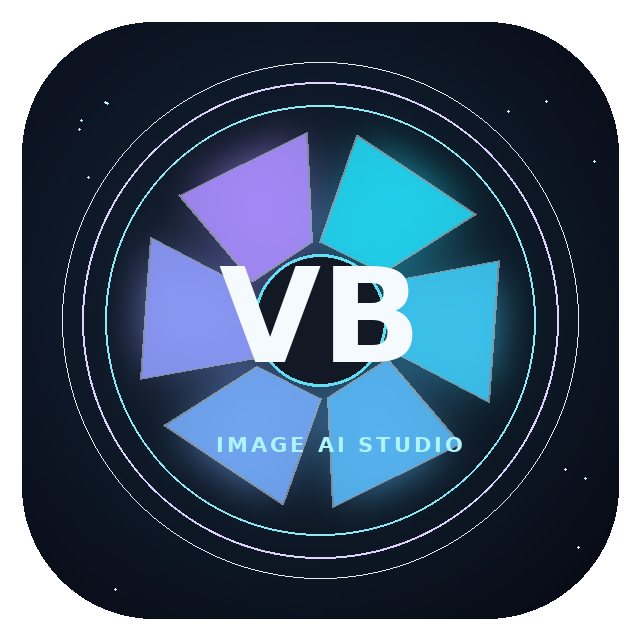
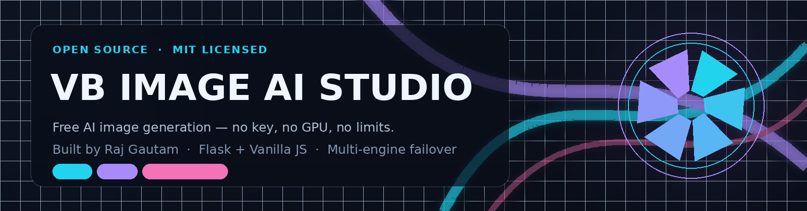
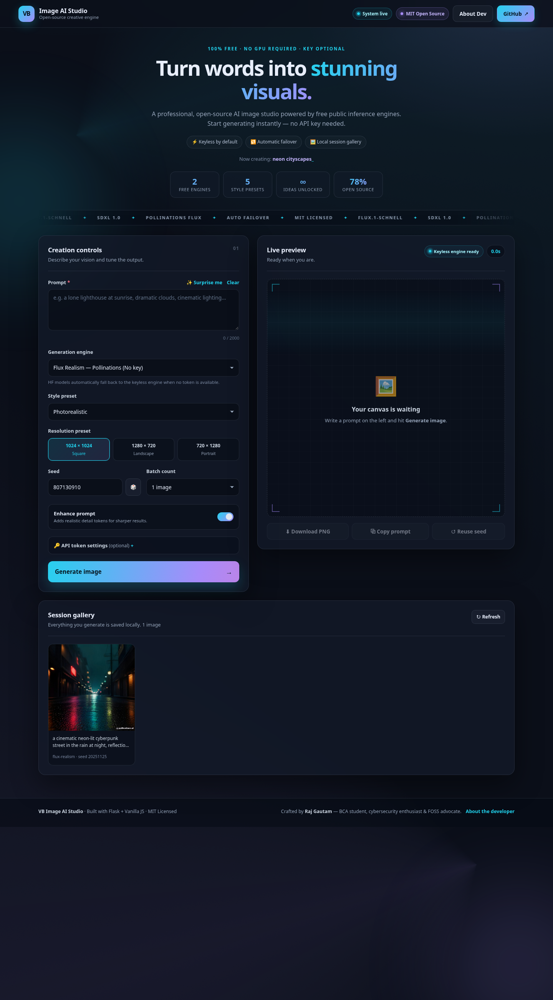
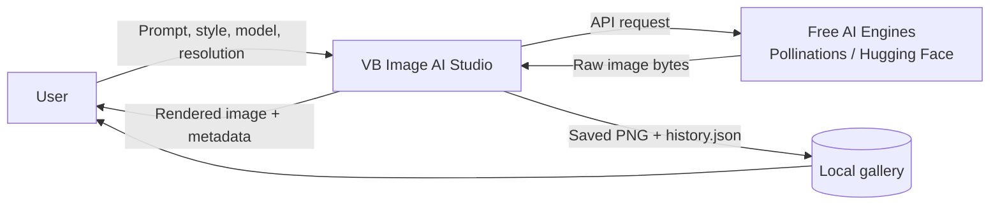
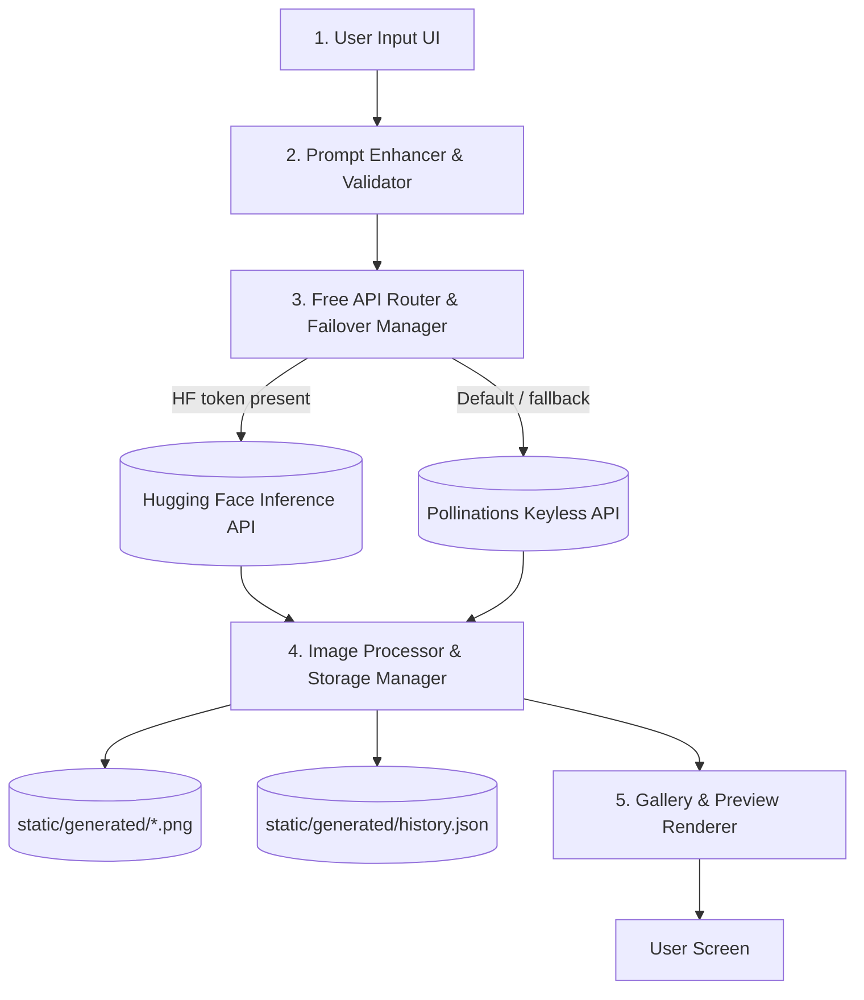
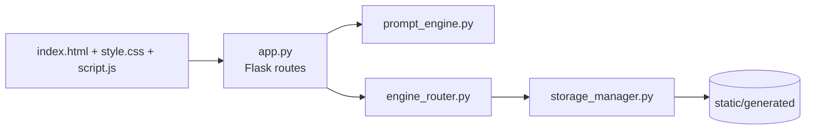

<div align="center">
  
  <h1>VB Image AI Studio</h1>
  <p><strong>Free, open-source AI image generation — no key, no GPU, no limits.</strong></p>
  <p><a href="https://github.com/Rg100152/vb-image">⭐ Star the repository on GitHub</a></p>
  <p>
    
    
    
    
  </p>
</div>



## 🖥️ Interface preview

<p align="center"><em>Real screenshot of the running app — controls, live preview, generated artwork and session gallery.</em></p>



---

**A free, open-source, production-ready AI image generation studio built with Flask and Vanilla JavaScript.**

Generate high-quality images with **no API key and no GPU**. The app routes requests to free public inference engines, retries on failure, automatically falls back to a keyless provider, and saves every result in a local session gallery. The interface includes animated aurora lighting, a pointer-follow glow, live engine status, count-up stats, a marquee, scroll reveals and a live generation timer for a modern dynamic feel.

---

## ✨ Features

- 🆓 **100% free operation** — keyless Pollinations engine works out of the box
- 🔁 **Automatic multi-engine failover** — retries timeouts/rate limits and switches provider
- ⚡ **Optional Hugging Face boost** — FLUX.1-Schnell and SDXL 1.0 with a free read token
- 🧠 **Prompt enhancer** — realism tokens, negative prompt and 7 style presets
- 🖼️ **Session gallery** — timestamped PNG files + `history.json` metadata log
- ⬇️ **Export actions** — download PNG, copy prompt, reuse seed, delete image
- 🎲 **Batch generation** — generate up to 4 images in one click
- 🌙 **Dynamic glassmorphic UI** — animated aurora, cursor glow, live engine status, count-up stats, marquee, scroll reveals, skeleton loader and generation timer
- ⌨️ **Power-user shortcuts** — `Ctrl/⌘ + Enter` to generate, `Esc` to close dialogs
- 🔐 **Privacy-minded** — optional token stays in your browser's localStorage only
- 📘 **Documented engineering** — full SRS + DFD embedded below

---

## 🚀 Quick start

```bash
# 1. Create and activate a virtual environment
python3 -m venv venv
source venv/bin/activate          # Windows: venv\Scripts\activate

# 2. Install dependencies
pip install --upgrade pip
pip install -r requirements.txt

# 3. (Optional) add a free Hugging Face token
cp .env.example .env              # Windows: copy .env.example .env
# edit .env and set HF_API_KEY=hf_...

# 4. Run the server
python app.py
```

Open **http://127.0.0.1:5000** in your browser. No key is required — generation starts immediately.

---

## 🧱 Project structure

```txt
vb-image/
├── app.py                  # Flask server & JSON API endpoints
├── engine_router.py        # Sub-system 1: free APIs, retries & failover
├── prompt_engine.py        # Sub-system 2: validation, enhancer, style presets
├── storage_manager.py      # Sub-system 3: PNG storage & JSON history
├── requirements.txt        # Python dependencies
├── .env.example            # Optional HF_API_KEY template
├── .gitignore              # Python/env/generated ignores
├── LICENSE                 # MIT License (Raj Gautam)
├── README.md               # This document (SRS + DFD + setup)
├── docs/
│   ├── logo.png            # Project logo
│   ├── banner.png          # GitHub / website banner
│   ├── screenshot.png      # Real interface screenshot
│   └── generate_assets.py  # Reproducible asset generator
├── templates/
│   └── index.html          # Glassmorphic single-page UI + developer modal
└── static/
    ├── css/style.css       # Dark neon theme
    ├── js/script.js        # Async frontend controller
    └── generated/
        └── .gitkeep        # Local image storage (git-ignored contents)
```

---

## 🔌 HTTP API

| Method | Endpoint | Description |
| ------ | -------- | ----------- |
| `GET` | `/` | Render the studio UI |
| `POST` | `/api/generate` | Generate and save an image |
| `GET` | `/api/gallery` | List saved images (newest first) |
| `DELETE` | `/api/gallery/<filename>` | Delete a saved image |
| `GET` | `/api/models` | List supported model IDs |
| `GET` | `/api/health` | Health check |

### Example request

```bash
curl -X POST http://127.0.0.1:5000/api/generate \
  -H "Content-Type: application/json" \
  -d '{"prompt":"a lighthouse at sunrise","model":"pollinations-flux-realism","width":1024,"height":1024,"seed":0,"enhance":true,"style":"cinematic"}'
```

### Example response

```json
{
  "status": "success",
  "image_url": "/static/generated/20261125_153012_42_918273645.png",
  "filename": "20261125_153012_42_918273645.png",
  "seed_used": 918273645,
  "prompt_used": "a lighthouse at sunrise, cinematic still, ...",
  "model_used": "flux-realism",
  "engine": "pollinations",
  "note": ""
}
```

Errors are returned as `{ "status": "error", "error": "..." }` with an appropriate HTTP status code.

---

## 🧭 Software Requirements Specification (SRS)

### 1. Executive summary

VB Image AI Studio is a modular, open-source web platform that generates images exclusively through **free** AI APIs with automatic multi-provider failover, so users can create unlimited images for free, with or without an API key.

### 2. Functional requirements

| Sub-system | Module | Responsibility |
| ---------- | ------ | -------------- |
| 1 | `engine_router.py` | Pollinations (keyless) + Hugging Face (optional token), retry & failover |
| 2 | `prompt_engine.py` | Input validation, realism enhancer, negative prompt, 7 style presets |
| 3 | `storage_manager.py` | PNG normalisation, timestamped files, `history.json`, deletion |
| 4 | `templates/`, `static/` | Glassmorphic UI, timer, skeleton loader, presets, batch, gallery |
| 5 | repo docs | MIT license, developer identity modal/footer, professional README |

### 3. Non-functional requirements

- **Performance:** asynchronous `fetch` calls keep the browser responsive; read timeouts and bounded retries prevent hangs.
- **Security:** prompt sanitisation, path-traversal-safe deletes, no hardcoded secrets, token only in browser localStorage or `.env` (git-ignored).
- **Portability:** Python 3.8+, Linux / macOS / Windows, no local GPU required.
- **Maintainability:** each sub-system is an isolated module with a single responsibility.

### 4. Supported models

| ID | Engine | Key required |
| -- | ------ | ------------ |
| `pollinations-flux-realism` | Pollinations Flux Realism (default) | No |
| `pollinations-flux` | Pollinations Flux | No |
| `pollinations-turbo` | Pollinations Turbo | No |
| `pollinations-any-dark` | Pollinations Any Dark | No |
| `hf-flux` | black-forest-labs/FLUX.1-schnell | Free HF read token |
| `hf-sdxl` | stabilityai/stable-diffusion-xl-base-1.0 | Free HF read token |

HF requests made without a token automatically fall back to the keyless engine.

---

## 🗺️ Data Flow Diagrams (DFD)

### Level 0 — Context diagram



### Level 1 — Internal sub-system flow



### Architecture layers



---

## 🔧 Configuration

Create `.env` from `.env.example` if you want the Hugging Face engine:

```env
HF_API_KEY=hf_your_free_read_token_here
FLASK_DEBUG=0
LOG_LEVEL=INFO
```

You can also paste a token directly in the UI's **API token settings** panel; it is saved to `localStorage` on this device only and sent with your requests. Never commit `.env` or tokens to Git.

---

## 🛠️ Troubleshooting

- **"All free engines failed"** — check your internet connection; public APIs may rate-limit during peak hours. Try another model or wait a minute.
- **HF model falls back automatically** — no token was found in `.env` or the UI. Add a free token to unlock FLUX/SDXL.
- **Images are missing from the gallery** — `static/generated/` must be writable by the server process.
- **Port 5000 busy** — run `FLASK_DEBUG=0 python app.py` after stopping the conflicting service, or change the port in `app.py`.

---

## 👨‍💻 Developer

**Raj Gautam** — BCA student, cybersecurity enthusiast, Linux & FOSS advocate, and AI tool builder.

> "Passionate about open-source technology, cybersecurity, and building accessible AI tools for everyone."

- Education: Bachelor of Computer Applications, Veer Bahadur Singh Purvanchal University, Jaunpur
- GitHub: [github.com/Rg100152](https://github.com/Rg100152)
- Instagram: [@linux.userraj](https://instagram.com/linux.userraj)
- YouTube: [@codeitraj](https://youtube.com/@codeitraj)

---

## 📄 License

Released under the [MIT License](LICENSE) — free to use, modify, and distribute with attribution.

© 2025 Raj Gautam
